# Portfólio Dev — Template Open Source

Um portfólio pronto para você colocar o seu nome, os seus projetos e publicar. Feito com **React**, **TypeScript** e **Vite**, em **português e inglês**, e pensado para ser personalizado **sem mexer no código dos componentes**: você edita arquivos de dados, troca imagens e escolhe as cores.


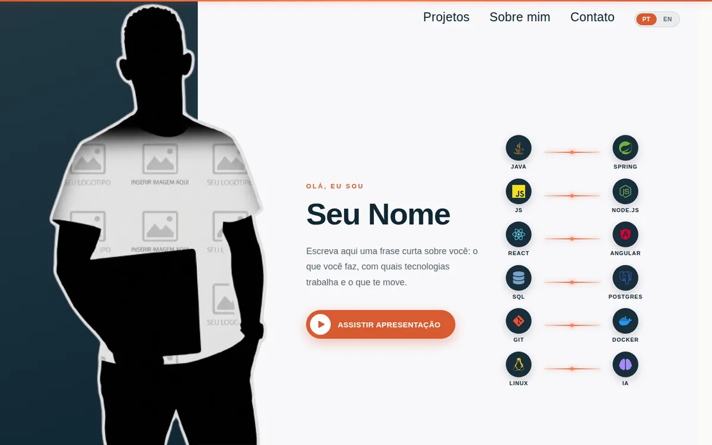

<p align="center">
  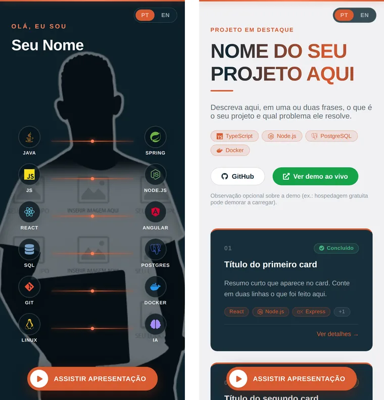
</p>

---

## Índice

- [Começando](#começando)
- [Mapa rápido: quero mudar X, onde eu mexo?](#mapa-rápido-quero-mudar-x-onde-eu-mexo)
- [Como o projeto está organizado](#como-o-projeto-está-organizado)
- [Parte 1 — Topo: nome, descrição, foto e vídeo](#parte-1--topo-nome-descrição-foto-e-vídeo)
- [Parte 2 — Trilha de tecnologias](#parte-2--trilha-de-tecnologias)
- [Parte 3 — Projetos](#parte-3--projetos)
- [Parte 4 — Sobre mim](#parte-4--sobre-mim)
- [Parte 5 — Estudos e certificados](#parte-5--estudos-e-certificados)
- [Parte 6 — Faixa de serviços e Contato](#parte-6--faixa-de-serviços-e-contato)
- [Parte 7 — Cores](#parte-7--cores)
- [Parte 8 — Textos e botões da interface](#parte-8--textos-e-botões-da-interface)
- [Parte 9 — Idiomas](#parte-9--idiomas)
- [Parte 10 — Mexendo nos componentes](#parte-10--mexendo-nos-componentes)
- [Guia de imagens](#guia-de-imagens)
- [Publicando o site](#publicando-o-site)
- [Dúvidas e suporte](#dúvidas-e-suporte)
- [Licença](#licença)

---

## Começando

Você precisa do [Node.js](https://nodejs.org) 22.12 ou mais recente.

**1. Crie a sua cópia.** Na [página do repositório](https://github.com/joao4692/portfolio-template-react), clique no botão verde **Use this template** → **Create a new repository**. Isso cria um repositório seu, já com todos os arquivos.

**2. Baixe e rode**, trocando `seu-usuario` e `meu-portfolio` pelos seus:

```bash
git clone https://github.com/seu-usuario/meu-portfolio.git
cd meu-portfolio
npm install
npm run dev
```

<details>
<summary>Prefere só testar, sem criar repositório?</summary>

```bash
git clone https://github.com/joao4692/portfolio-template-react.git meu-portfolio
cd meu-portfolio
npm install
npm run dev
```

</details>

Abra `http://localhost:5173` no navegador. O site recarrega sozinho a cada arquivo salvo.

| Comando | O que faz |
|---|---|
| `npm run dev` | abre o site no seu computador, com recarga automática |
| `npm run build` | confere o código e gera a versão final na pasta `dist/` |
| `npm run preview` | mostra a versão final gerada pelo build |
| `npm run lint` | procura problemas no código |
| `npm run format` | padroniza a formatação de todos os arquivos (Prettier) |

> **Dica:** rode `npm run build` depois de editar os dados. Se você esquecer um campo ou digitar um nome errado, o build aponta o arquivo e a linha.

---

## Mapa rápido: quero mudar X, onde eu mexo?

| Quero mudar... | Arquivo |
|---|---|
| Nome, descrição, foto do topo, link do vídeo | `src/data/portfolioData.ts` → `perfil` |
| Tecnologias da trilha do topo | `src/data/portfolioData.ts` → `trilha` |
| Texto do "Sobre mim" e imagem de fundo | `src/data/portfolioData.ts` → `sobre` |
| Formação, cursos e certificados | `src/data/portfolioData.ts` → `estudos` |
| Lista de serviços da faixa colorida | `src/data/portfolioData.ts` → `servicos` |
| Links de LinkedIn, GitHub, Instagram, WhatsApp | `src/data/portfolioData.ts` → `contatos` |
| Projetos (título, cards, status, tecnologias, fotos) | `src/data/projetoData.ts` |
| Cores do site | `src/theme.css` |
| Rótulos e botões ("SOBRE MIM", "Ver detalhes"...) | `src/i18n/translations.ts` |
| Imagens | pasta `public/` |
| Título da aba do navegador | `index.html` → `<title>` |
| Ordem das seções, ou remover uma seção | `src/App.tsx` |
| Layout e estilo de uma seção | `src/components/<Seção>/` |

---

## Como o projeto está organizado

```
meu-portfolio/
├── public/                     ← IMAGENS (o que está aqui vai direto para o site)
│   ├── perfil/                 foto do topo e fundo do "Sobre mim"
│   ├── projetos/
│   │   ├── card-1/             fotos do 1º card de projeto
│   │   ├── card-2/             fotos do 2º card
│   │   └── card-3/             fotos do 3º card
│   └── certificados/
│       ├── card-1/             certificados do 1º card de estudos
│       ├── card-2/             certificados do 2º card
│       └── card-3/             certificados do 3º card
│
├── src/
│   ├── data/                   ← SEU CONTEÚDO
│   │   ├── portfolioData.ts    perfil, trilha, sobre, estudos, serviços, contatos
│   │   ├── projetoData.ts      seção de projetos
│   │   └── types.ts            formato dos dados (normalmente você não edita)
│   │
│   ├── theme.css               ← CORES do site
│   │
│   ├── i18n/                   ← IDIOMAS
│   │   ├── translations.ts     rótulos e botões da interface, em pt e en
│   │   └── ...                 troca de idioma (provider, hook, botão PT/EN)
│   │
│   ├── components/             ← SEÇÕES do site (um .tsx + um .css por pasta)
│   │   ├── Projetos/
│   │   ├── Sobre/
│   │   ├── Estudos/
│   │   ├── Divulgar/           faixa de serviços
│   │   ├── Contato/
│   │   └── TextoComDestaque/   transforma **texto** em negrito
│   │
│   ├── App.tsx                 menu, topo, trilha, rodapé e a ordem das seções
│   └── App.css
│
└── index.html                  título da aba do navegador
```

**As três regras do template:**

1. **Conteúdo fica em `src/data/`.** Os componentes só exibem o que está lá.
2. **Imagem fica em `public/`, e no arquivo de dados vai só o nome dela.** Exemplo: o arquivo `public/perfil/foto.webp` aparece nos dados como `foto: 'foto.webp'`.
3. **Todo texto visível tem duas versões**, `pt` e `en`. É o que faz o botão PT/EN funcionar.

```ts
// assim é um texto com dois idiomas
descricao: {
  pt: 'Desenvolvedora front-end.',
  en: 'Front-end developer.',
},
```

---

## Parte 1 — Topo: nome, descrição, foto e vídeo


**Arquivo:** `src/data/portfolioData.ts`, bloco `perfil`.

```ts
export const perfil = {
  nome: {
    pt: 'Seu Nome',
    en: 'Your Name',
  },
  // aparece no rodapé, seguido de um ponto colorido
  marca: {
    pt: 'seunome',
    en: 'yourname',
  },
  videoApresentacao: 'https://www.youtube.com/watch?v=SEU_VIDEO_ID',
  descricao: {
    pt: 'Uma frase curta sobre você.',
    en: 'A short sentence about you.',
  },
  // arquivo em public/perfil/
  foto: 'foto.webp',
}
```

| Campo | Onde aparece |
|---|---|
| `nome` | título grande do topo e linha de direitos autorais do rodapé |
| `marca` | rodapé |
| `descricao` | parágrafo abaixo do nome |
| `videoApresentacao` | link do botão "ASSISTIR APRESENTAÇÃO" |
| `foto` | foto grande à esquerda (no celular, vira o fundo do topo) |

### Como trocar a foto

1. Coloque a sua foto em `public/perfil/`. Exemplo: `public/perfil/minha-foto.png`.
2. Em `perfil`, troque o nome: `foto: 'minha-foto.png'`.
3. Pode apagar a `foto.webp` de exemplo.

A foto fica melhor em **retrato** (mais alta que larga) e com **fundo transparente** (PNG ou WebP), porque ela se sobrepõe ao fundo do site. Tamanhos recomendados no [Guia de imagens](#guia-de-imagens).

---

## Parte 2 — Trilha de tecnologias

São os ícones em pares ao lado do seu nome.

**Arquivo:** `src/data/portfolioData.ts`, bloco `trilha`. Cada linha é um par (esquerda, direita):

```ts
export const trilha: [TecnologiaId, TecnologiaId][] = [
  ['java', 'spring'],
  ['javascript', 'node'],
  ['react', 'angular'],
]
```

Tecnologias disponíveis:

| | | | | |
|---|---|---|---|---|
| `java` | `spring` | `javascript` | `typescript` | `react` |
| `angular` | `nextjs` | `node` | `nestjs` | `python` |
| `html` | `css` | `tailwind` | `sql` | `postgres` |
| `mongodb` | `firebase` | `graphql` | `restapi` | `git` |
| `docker` | `linux` | `aws` | `ia` | `ciberseguranca` |

Se você digitar um nome que não existe, o editor e o `npm run build` avisam.

<details>
<summary><b>Adicionar uma tecnologia que não está na lista</b></summary>

São três passos, usando Kotlin como exemplo:

1. Em `src/data/types.ts`, acrescente o id em `TecnologiaId`:
   ```ts
   | 'git' | 'docker' | 'linux' | 'aws' | 'ia' | 'ciberseguranca' | 'kotlin'
   ```
2. Em `src/App.tsx`, importe o ícone do [react-icons](https://react-icons.github.io/react-icons/) e acrescente uma linha no catálogo `TECNOLOGIAS`:
   ```tsx
   import { SiKotlin } from 'react-icons/si'

   kotlin: { icone: <SiKotlin />, cor: 'arco-kotlin', nome: { pt: 'Kotlin', en: 'Kotlin' } },
   ```
3. Em `src/App.css`, crie a cor do ícone, perto das outras classes `arco-`:
   ```css
   .arco-kotlin {
     color: #7f52ff;
   }
   ```

</details>

---

## Parte 3 — Projetos

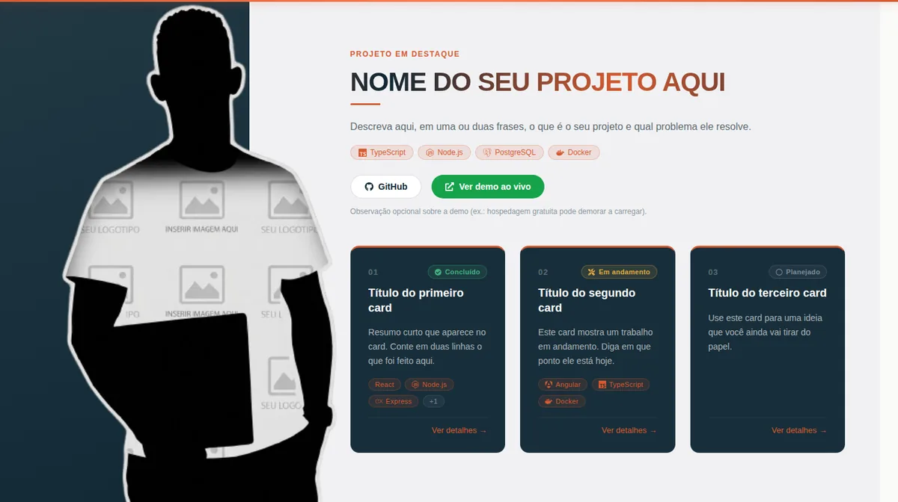

**Arquivo:** `src/data/projetoData.ts`.

A seção tem um **cabeçalho** (título, descrição, tecnologias e links) e os **cards** logo abaixo. O template vem com 3 cards de exemplo. Cada card pode ser um projeto, uma ideia ou uma etapa de um projeto maior.

### Cabeçalho

```ts
export const projetoDestaque: ProjetoDestaque = {
  titulo: { pt: 'Meus Projetos', en: 'My Projects' },
  descricao: {
    pt: 'O que eu venho construindo.',
    en: 'What I have been building.',
  },
  tecnologias: ['TypeScript', 'Node.js', 'PostgreSQL', 'Docker'], // opcional
  github: 'https://github.com/seu-usuario/seu-projeto',           // opcional
  demo: 'https://seu-projeto.exemplo.com',                        // opcional
  notaDemo: { pt: 'Observação sobre a demo.', en: 'Note about the demo.' }, // opcional
  etapas: [ /* os cards ficam aqui */ ],
}
```

### Um card

```ts
{
  numero: '01',
  status: 'concluido',                                   // opcional
  tecnologias: ['TypeScript', 'Node.js', 'PostgreSQL'],  // opcional
  // arquivos em public/projetos/card-1/
  fotos: ['card-1/principal.svg', 'card-1/detalhe-1.svg', 'card-1/detalhe-2.svg'], // opcional
  github: 'https://github.com/seu-usuario/seu-projeto',  // opcional
  textos: {
    pt: {
      titulo: 'Título do card',
      resumo: 'Descrição curta que aparece no card.',
      topicos: [                                         // opcional
        { titulo: 'Objetivo', conteudo: 'O que você queria resolver.' },
        { titulo: 'Aprendizados', conteudo: 'O que você aprendeu.' },
      ],
    },
    en: {
      titulo: 'Card title',
      resumo: 'Short description shown on the card.',
      topicos: [
        { titulo: 'Objective', conteudo: 'What you wanted to solve.' },
        { titulo: 'Learnings', conteudo: 'What you learned.' },
      ],
    },
  },
},
```

| Campo | Obrigatório? | O que é |
|---|---|---|
| `numero` | sim | número que aparece no canto do card |
| `textos.titulo` | sim | título do card |
| `textos.resumo` | sim | descrição curta do card |
| `status` | não | selo: `'concluido'`, `'em-andamento'` ou `'planejado'` |
| `tecnologias` | não | etiquetas de ferramentas; o card mostra as 3 primeiras e um "+N" |
| `fotos` | não | imagens que aparecem ao abrir o card |
| `github` | não | botão "Ver código" dentro do card aberto |
| `textos.topicos` | não | blocos de texto (subtítulo + conteúdo) dentro do card aberto |

**Tudo que é opcional pode ser apagado:** remova a linha e a parte some do site, sem deixar espaço vazio.

- **Mais cards:** copie um bloco inteiro, de `{` até `},`, dentro de `etapas`.
- **Menos cards:** apague um bloco.

### O card aberto

Ao clicar em um card, abre uma janela com as fotos, o status, as tecnologias e os tópicos.

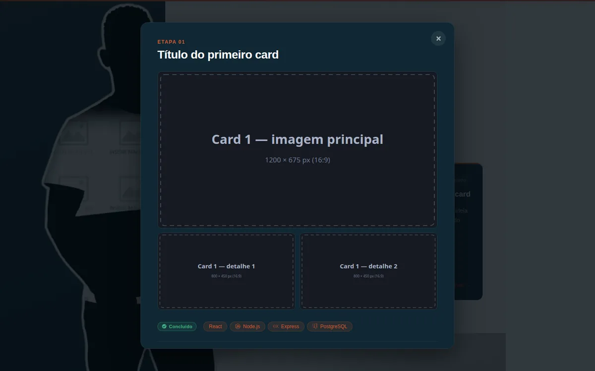

### Fotos de cada card

Cada card tem a sua pasta:

```
public/projetos/
├── card-1/   principal.svg   detalhe-1.svg   detalhe-2.svg
├── card-2/   principal.svg   detalhe-1.svg   detalhe-2.svg
└── card-3/   principal.svg   detalhe-1.svg   detalhe-2.svg
```

Os arquivos `.svg` que vêm no template são **moldes**: mostram o tamanho de cada imagem. Para usar as suas:

1. Coloque as fotos na pasta do card. Exemplo: `public/projetos/card-1/tela-inicial.png`.
2. Atualize a lista `fotos` do card:
   ```ts
   fotos: ['card-1/tela-inicial.png', 'card-1/login.png', 'card-1/painel.png'],
   ```
3. Apague os moldes que não usar.

A **primeira** foto da lista é a principal (grande). As **duas seguintes** são os detalhes (menores). Clicar em uma foto a amplia.

> Se um card não vai ter fotos, apague a linha `fotos` e acrescente `semFotos: true`. Sem isso, o card aberto mostra um molde com as medidas, para lembrar você de colocar as imagens.

<details>
<summary><b>Ícones nas etiquetas de tecnologia</b></summary>

Você pode escrever qualquer nome em `tecnologias`. Estes ganham ícone automaticamente:

`Node.js` · `PostgreSQL` · `Docker` · `Docker Compose` · `Python` · `TypeScript` · `Express` · `Prisma` · `JWT` · `Angular` · `OpenCV` · `Zod` · `Render`

Os outros aparecem só com o texto. Para dar ícone a mais um, abra `src/components/Projetos/Projetos.tsx` e acrescente uma linha no catálogo `TECH_ICONS`:

```tsx
import { SiReact } from 'react-icons/si'

const TECH_ICONS: Record<string, ReactNode> = {
  // ...
  React: <SiReact />,
}
```

O nome à esquerda precisa ser igual ao que você escreve em `tecnologias`.

</details>

---

## Parte 4 — Sobre mim

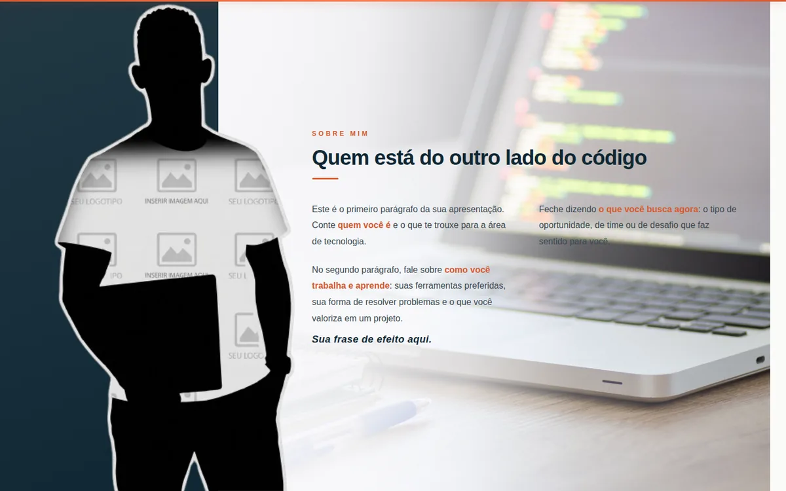

**Arquivo:** `src/data/portfolioData.ts`, bloco `sobre`.

```ts
export const sobre = {
  // arquivo em public/perfil/
  imagemFundo: 'sobre-bg.jpg',
  paragrafos: {
    pt: [
      'Primeiro parágrafo. Use **asteriscos duplos** para destacar um trecho.',
      'Segundo parágrafo.',
    ],
    en: [
      'First paragraph. Use **double asterisks** to highlight a passage.',
      'Second paragraph.',
    ],
  },
  lema: {
    pt: 'Sua frase de efeito aqui.',
    en: 'Your motto here.',
  },
}
```

- Cada item entre aspas vira **um parágrafo**. Acrescente ou remova itens à vontade, mantendo a mesma quantidade em `pt` e `en`.
- Um trecho entre `**asteriscos duplos**` aparece em **negrito e na cor primária**.
- `lema` é a frase em itálico no fim do texto.
- Para trocar a imagem de fundo, coloque a nova em `public/perfil/` e escreva o nome em `imagemFundo`.

---

## Parte 5 — Estudos e certificados

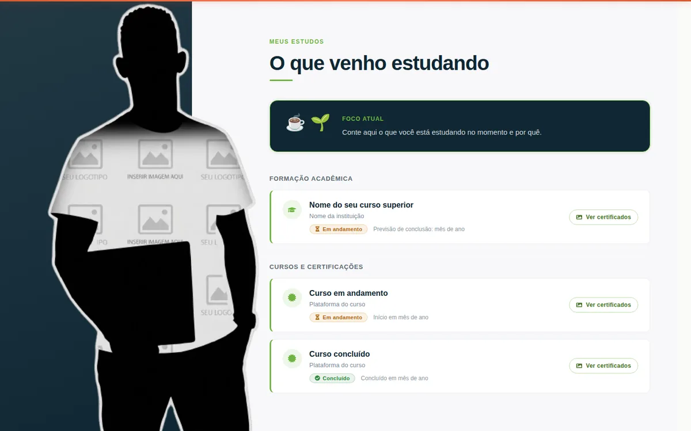

**Arquivo:** `src/data/portfolioData.ts`, bloco `estudos`.

A seção tem três partes: o **foco atual** (a caixa escura), a **formação acadêmica** e os **cursos**. Cada item das listas `formacao` e `cursos` vira um card.

```ts
export const estudos = {
  foco: {
    pt: 'O que você está estudando agora e por quê.',
    en: 'What you are studying now and why.',
  },
  formacao: [
    {
      titulo: { pt: 'Nome do curso superior', en: 'Name of your degree' },
      instituicao: { pt: 'Nome da instituição', en: 'Name of the institution' }, // opcional
      status: 'andamento',                       // 'andamento' ou 'concluido'
      data: { pt: 'Previsão: junho de 2027', en: 'Expected: June 2027' },
      // arquivos em public/certificados/card-1/
      certificados: ['card-1/certificado.svg'],  // opcional
    },
  ],
  cursos: [
    // mesmo formato da formação
  ],
}
```

### Certificados

O botão "Ver certificados" de cada card abre os arquivos daquele card.

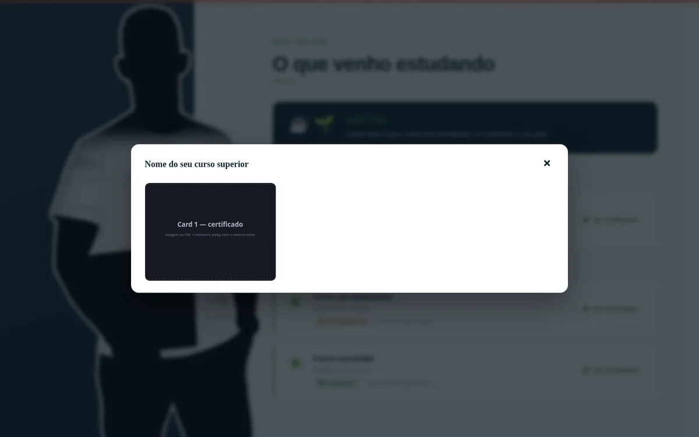

Assim como nos projetos, cada card tem a sua pasta:

```
public/certificados/
├── card-1/   certificado.svg
├── card-2/   certificado.svg
└── card-3/   certificado.svg
```

1. Coloque o seu certificado na pasta do card.
2. Escreva o caminho na lista `certificados` do card.
3. Um card pode ter vários certificados: `certificados: ['card-3/modulo-1.png', 'card-3/modulo-2.png']`.

**Dois formatos funcionam:**

| Formato | O que colocar na pasta | O que escrever nos dados |
|---|---|---|
| Imagem (`.webp`, `.png`, `.jpg`) | só a imagem | `'card-1/diploma.png'` |
| PDF | o PDF **e** uma miniatura `.webp` com o mesmo nome (`diploma.pdf` + `diploma.webp`) | `'card-1/diploma.pdf'` |

No caso do PDF, a miniatura é o que aparece na janela; ao clicar, o PDF abre em outra aba.

---

## Parte 6 — Faixa de serviços e Contato

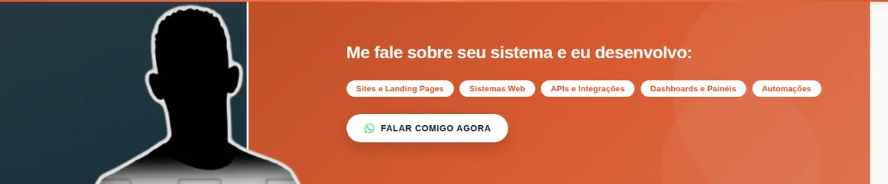

**Arquivo:** `src/data/portfolioData.ts`, blocos `servicos` e `contatos`.

```ts
// etiquetas da faixa colorida; as duas listas devem ter os mesmos itens
export const servicos = {
  pt: ['Sites e Landing Pages', 'Sistemas Web', 'APIs e Integrações'],
  en: ['Websites and Landing Pages', 'Web Systems', 'APIs and Integrations'],
}

export const contatos = {
  linkedin: 'https://www.linkedin.com/in/seu-usuario',
  github: 'https://github.com/seu-usuario',
  instagram: 'https://instagram.com/seu-usuario',
  whatsapp: 'https://wa.me/5500000000000',
}
```

- O botão **"FALAR COMIGO AGORA"** da faixa usa o link de `contatos.whatsapp`.
- No WhatsApp, escreva **código do país + DDD + número, só dígitos**. Exemplo para o Brasil: `https://wa.me/5511999998888`.

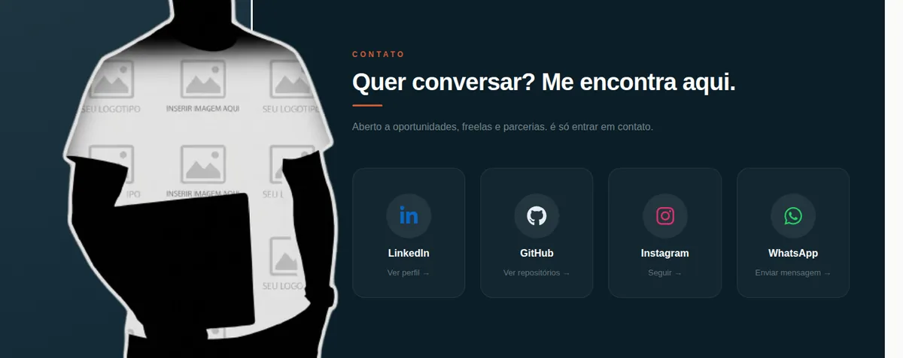

---

## Parte 7 — Cores

O site inteiro usa **4 cores**, definidas em um arquivo só.

**Arquivo:** `src/theme.css`.

```css
:root {
  --cor-primaria: #d85a30;    /* destaque: botões, links, faixa de serviços */
  --cor-secundaria: #0f2733;  /* fundos escuros e textos principais */
  --cor-terciaria: #6db33f;   /* destaque da seção Estudos */
  --cor-quaternaria: #f8f8fa; /* fundo das seções claras */
}
```

Troque um valor, salve, e o site inteiro acompanha. Na imagem abaixo, à esquerda a paleta padrão e à direita o mesmo site depois de trocar `--cor-primaria` para `#2563eb`:

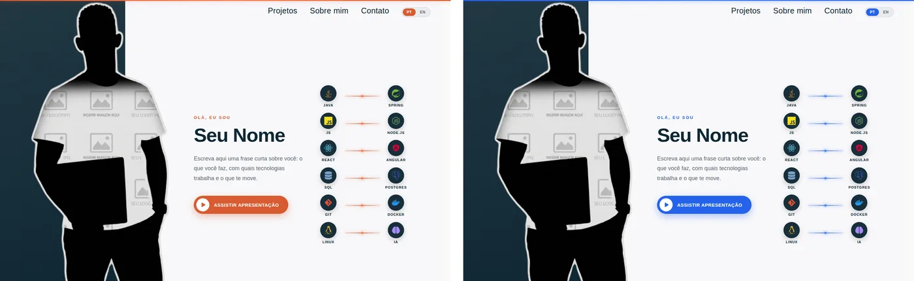

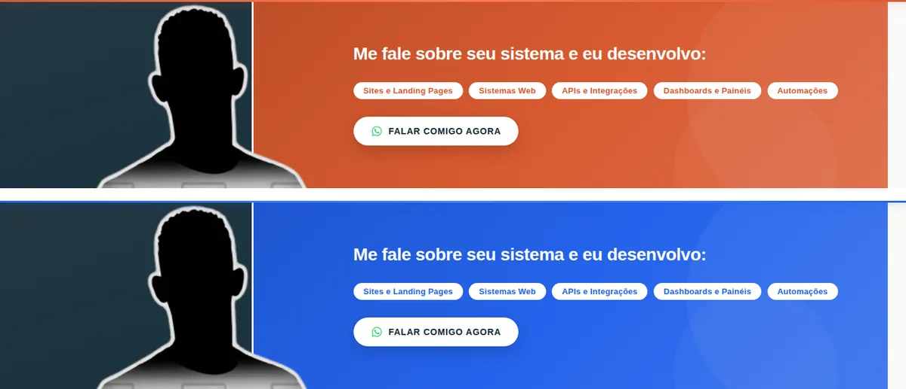

**Como escolher bem:**

| Variável | Precisa ser | Por quê |
|---|---|---|
| `--cor-primaria` | uma cor viva, de tom médio | fica atrás de texto branco nos botões |
| `--cor-secundaria` | uma cor **escura** | é fundo de texto branco e cor de texto sobre fundo claro |
| `--cor-terciaria` | uma cor viva, de tom médio | marca os detalhes da seção Estudos |
| `--cor-quaternaria` | uma cor **bem clara** | é o fundo das seções com texto escuro |

Os tons mais claros e mais escuros (degradês, botão ao passar o mouse, sombras coloridas) são **calculados automaticamente** a partir dessas quatro. Eles ficam na segunda parte do `theme.css`, e normalmente você não precisa mexer ali.

**O que não muda com a paleta, de propósito:**

- as cores oficiais das marcas (ícones das tecnologias, LinkedIn, WhatsApp, Instagram);
- os selos de status (verde de "Concluído", amarelo de "Em andamento");
- branco, preto e os cinzas dos textos secundários.

Para um ajuste que a paleta não cobre, edite direto o CSS da seção, em `src/components/<Seção>/<Seção>.css`.

---

## Parte 8 — Textos e botões da interface

Os textos que **não são seus dados** (títulos de seção, rótulos, botões) ficam em um arquivo só.

**Arquivo:** `src/i18n/translations.ts`.

Ele tem dois blocos, `pt` e `en`, divididos por seção do site:

```ts
const pt = {
  app: {
    navProjetos: 'Projetos',
    heroLabel: 'OLÁ, EU SOU',
    heroBotao: 'ASSISTIR APRESENTAÇÃO',
    // ...
  },
  sobre: {
    label: 'SOBRE MIM',
    titulo: 'Quem está do outro lado do código',
  },
  // projetos, estudos, divulgar, contato...
}
```

| Seção do arquivo | O que tem |
|---|---|
| `app` | menu, saudação do topo, botão do vídeo, rodapé |
| `projetos` | "Projeto em destaque", "Ver detalhes", "Ver código", nomes dos status |
| `sobre` | rótulo e título da seção |
| `estudos` | rótulo, título, "Foco atual", "Ver certificados", nomes dos status |
| `divulgar` | título da faixa e texto do botão |
| `contato` | rótulo, título, subtítulo e a ação de cada rede ("Ver perfil"...) |

**Para trocar um texto:** ache a seção, mude a frase em `pt` e a correspondente em `en`.

> Os dois blocos precisam ter as mesmas chaves. Se você criar um texto em `pt` e esquecer do `en`, o `npm run build` avisa.

**Exemplo:** dentro do card de projeto aberto aparece "Etapa 01". Para mostrar "Projeto 01", troque em `projetos`: `etapa: 'Projeto'` no `pt` e `etapa: 'Project'` no `en`.

---

## Parte 9 — Idiomas

O botão **PT / EN** troca o idioma do site inteiro e lembra a escolha do visitante.

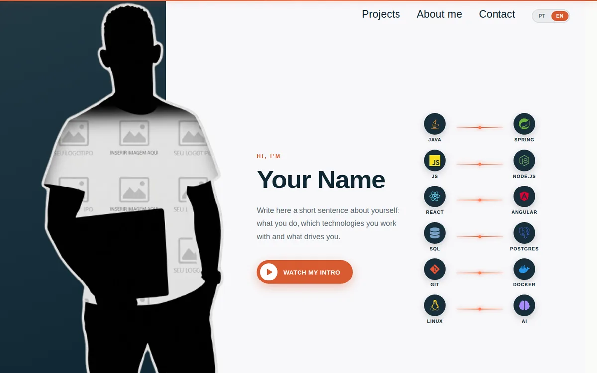

O conteúdo de cada idioma vem de dois lugares:

| O quê | Onde |
|---|---|
| Seus dados (nome, bio, projetos, estudos) | `src/data/`, nos campos `{ pt, en }` |
| Rótulos e botões da interface | `src/i18n/translations.ts`, nos blocos `pt` e `en` |

**Quer o site em um idioma só?** O caminho mais simples é escrever o mesmo texto em `pt` e `en` e remover o botão de troca: em `src/App.tsx`, apague as duas linhas `<LanguageSwitch />`.

<details>
<summary><b>Adicionar um terceiro idioma (avançado)</b></summary>

Usando espanhol como exemplo:

1. `src/i18n/context.ts`: acrescente o idioma ao tipo `Lang`.
   ```ts
   export type Lang = 'pt' | 'en' | 'es'
   ```
2. Rode `npm run build`. O TypeScript vai listar **todos** os lugares onde falta o texto em espanhol.
3. `src/i18n/translations.ts`: crie o bloco `const es: typeof pt = { ... }` e inclua-o na última linha: `{ pt, en, es }`.
4. `src/data/portfolioData.ts` e `projetoData.ts`: acrescente `es: '...'` em cada texto.
5. `src/App.tsx`: acrescente `es` ao nome de cada tecnologia no catálogo `TECNOLOGIAS`.
6. `src/i18n/LanguageSwitch.tsx`: copie um dos botões e adapte para `es`.
7. `src/i18n/LanguageProvider.tsx`: ajuste o código do idioma da página para o novo valor.

</details>

---

## Parte 10 — Mexendo nos componentes

Você só precisa desta parte se quiser mudar **layout ou comportamento**. Para conteúdo, cores e textos, as partes anteriores bastam.

Cada seção do site é uma pasta com dois arquivos: a estrutura (`.tsx`) e o estilo (`.css`).

| Seção no site | Pasta |
|---|---|
| Menu, topo, trilha e rodapé | `src/App.tsx` + `src/App.css` |
| Projetos | `src/components/Projetos/` |
| Sobre mim | `src/components/Sobre/` |
| Estudos | `src/components/Estudos/` |
| Faixa de serviços | `src/components/Divulgar/` |
| Contato | `src/components/Contato/` |
| Botão PT / EN | `src/i18n/LanguageSwitch.tsx` + `.css` |

### Mudar a ordem das seções ou remover uma

Em `src/App.tsx`, as seções aparecem na ordem em que estão escritas:

```tsx
<Projetos />
<Sobre />
<Estudos />
<Divulgar />
<Contato />
```

- **Reordenar:** troque as linhas de lugar.
- **Remover:** apague a linha. Se a seção tinha link no menu, apague também o link correspondente, logo acima no mesmo arquivo (`<a href="#sobre" ...>`).

### Mudar o estilo de uma seção

Abra o `.css` da pasta. Os nomes das classes dizem o que cada uma estiliza (`.sobre-titulo`, `.estudo-card`, `.contato-icon-wrap`), e são os mesmos que aparecem no `.tsx` ao lado. Os ajustes para celular e tablet ficam dentro dos blocos `@media`.

### Mudar as redes sociais do Contato

Os quatro botões (LinkedIn, GitHub, Instagram, WhatsApp) estão montados em `src/components/Contato/Contato.tsx`, na lista `redes`. Para remover uma rede, apague o bloco dela nessa lista. Para acrescentar uma, copie um bloco, troque o ícone e o link, e crie a classe de cor em `Contato.css`.

---

## Guia de imagens

| Imagem | Pasta | Formato | Tamanho recomendado |
|---|---|---|---|
| Foto do topo | `public/perfil/` | PNG ou WebP, **fundo transparente** | retrato, cerca de 800 × 1200 px |
| Fundo do "Sobre mim" | `public/perfil/` | JPG ou WebP | paisagem, 1920 px de largura |
| Projeto: foto principal | `public/projetos/card-N/` | WebP, PNG ou JPG | 1200 × 675 px (16:9) |
| Projeto: fotos de detalhe (até 2) | `public/projetos/card-N/` | WebP, PNG ou JPG | 800 × 450 px (16:9) |
| Certificado | `public/certificados/card-N/` | imagem, ou PDF + miniatura `.webp` | paisagem, cerca de 1600 px de largura |

**Dicas:**

- Prefira **WebP**: o arquivo fica bem menor que PNG ou JPG com a mesma qualidade. O [Squoosh](https://squoosh.app) converte direto no navegador.
- Evite espaços e acentos nos nomes de arquivo. Use `tela-inicial.webp`, não `Tela Inicial (1).webp`.
- Maiúsculas e minúsculas contam: `Foto.png` e `foto.png` são arquivos diferentes depois de publicado.
- Só use imagens que são suas ou que têm licença de uso livre.

---

## Publicando o site

Antes de publicar, confira o resultado final:

```bash
npm run build
npm run preview
```

<details>
<summary><b>Vercel (o mais simples)</b></summary>

1. Suba o projeto para o seu GitHub.
2. Em [vercel.com](https://vercel.com), clique em **Add New Project** e importe o repositório.
3. A Vercel reconhece o Vite sozinha. Clique em **Deploy**.

A cada `git push` na branch principal, o site é atualizado.

</details>

<details>
<summary><b>Netlify</b></summary>

1. Em [netlify.com](https://netlify.com), clique em **Add new site** e conecte o repositório.
2. Configure:
   - **Build command:** `npm run build`
   - **Publish directory:** `dist`
3. Clique em **Deploy site**.

</details>

<details>
<summary><b>GitHub Pages</b></summary>

1. Instale o publicador:
   ```bash
   npm install --save-dev gh-pages
   ```
2. Em `vite.config.ts`, informe o nome do seu repositório:
   ```ts
   export default defineConfig({
     base: '/nome-do-repositorio/',
     plugins: [react()],
   })
   ```
3. Em `package.json`, acrescente o script:
   ```json
   "deploy": "npm run build && gh-pages -d dist"
   ```
4. Publique:
   ```bash
   npm run deploy
   ```

O site fica em `https://seu-usuario.github.io/nome-do-repositorio/`.

> **Atenção:** no GitHub Pages o site fica dentro de uma subpasta, e os caminhos das imagens deste template começam na raiz (`/perfil/...`). Para as imagens aparecerem, use um domínio próprio ou um repositório chamado `seu-usuario.github.io`. Na Vercel e na Netlify isso não acontece.

</details>

---

## Dúvidas e suporte

Ficou com dúvida, encontrou um problema ou tem uma sugestão?

- **Abra uma issue** neste repositório descrevendo o que aconteceu. Se for um erro, cole a mensagem do terminal e diga qual arquivo você editou.
- **Fale comigo no GitHub:** [@joao4692](https://github.com/joao4692)

Contribuições são bem-vindas: faça um fork, crie uma branch com a sua mudança e abra um Pull Request.

Se este template te ajudou, deixe uma ⭐ no repositório.

---

## Licença

Distribuído sob a licença [MIT](LICENSE). Você pode usar, modificar e publicar o seu portfólio com este template, inclusive para fins comerciais, mantendo o aviso de licença.
